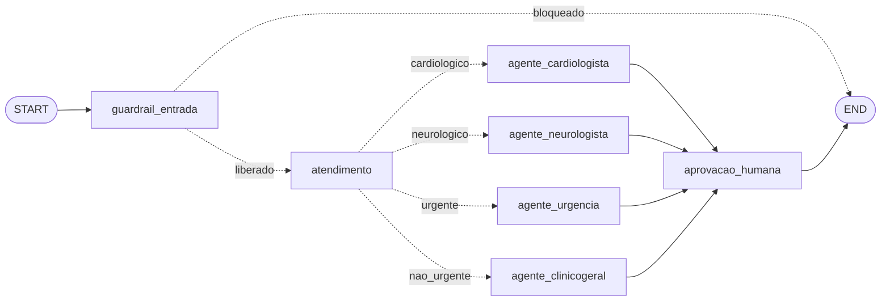

# susia

Sistema multiagente, construído com [LangGraph](https://langchain-ai.github.io/langgraph/), que recebe um prontuário médico e faz a triagem do atendimento.

> Projeto didático. Use apenas prontuários fictícios: ele não substitui avaliação clínica e não deve ser usado com dados reais de pacientes.

## Como funciona

O objetivo final é encaminhar cada prontuário para o agente certo:

- **cardiológico** → agente cardiologista
- **neurológico** → agente neurologista
- **urgente** → agente de emergência
- **não urgente** → agente clínico geral

### Etapa atual



- **`guardrail_entrada`**: primeira etapa, antes de qualquer chamada ao modelo. Mascara segredos e dados pessoais e bloqueia tentativas de injeção de prompt (detalhes em [Guardrail de entrada](#guardrail-de-entrada)).
- **`atendimento`**: lê o prontuário e pede ao modelo uma resposta estruturada com `urgencia`, `especialidade` (`"cardiologia"`, `"neurologia"` ou `"geral"`) e `justificativa`. Na dúvida, o prompt orienta a classificar como urgente.
- **Roteamento** ([src/edges/roteamento.py](src/edges/roteamento.py)): casos de cardiologia e de neurologia vão para o especialista (`agente_cardiologista` ou `agente_neurologista`), mesmo quando urgentes; os demais urgentes vão para o `agente_urgencia`; os não urgentes vão para o `agente_clinicogeral`.
- **`agente_cardiologista`**: agente com tool calling que separa os sintomas, consulta o CID-10 com `buscar_cid10` e emite um `parecer_cardiologico` com hipótese diagnóstica, risco (`alto`, `moderado` ou `baixo`) e condutas iniciais. Recebe também a classificação de urgência da triagem.
- **`agente_neurologista`**: mesmo padrão do cardiologista, com prompt de neurologia (prioriza códigos G e I60 a I69 e pede termos médicos nas buscas, como "disartria" em vez de "fala arrastada"). Emite um `parecer_neurologico` com hipótese diagnóstica, risco e condutas iniciais.
- **`agente_clinicogeral`**: atende os prontuários não urgentes e sem especialidade. Mesmo padrão do cardiologista (tool calling com `buscar_cid10`), emitindo um `parecer_clinico` com hipótese diagnóstica, orientações, exames e retorno. Se o prontuário não tiver queixas (por exemplo, renovação de receita), não faz buscas e devolve sintomas e CIDs vazios.
- **`agente_urgencia`**: só roda para prontuários urgentes sem especialidade (nem cardiológicos nem neurológicos). É um agente com tool calling: separa os sintomas e sinais do prontuário, consulta o CID-10 com a ferramenta `buscar_cid10` (uma chamada por sintoma) e devolve `sintomas` e `cids_sugeridos`. O prompt proíbe sugerir código que a ferramenta não devolveu.
- **`aprovacao_humana`**: última etapa. Pausa o fluxo até um profissional aprovar ou rejeitar o resultado do agente (detalhes em [Aprovação humana](#aprovação-humana)).

Para acrescentar um especialista, veja o passo a passo em [docs/NOVO_AGENTE.md](docs/NOVO_AGENTE.md). O exemplo usado é um `agente_pediatra`.

### Guardrail de entrada

O nó `guardrail_entrada` ([src/services/guardrail.py](src/services/guardrail.py)) verifica o prontuário com expressões regulares, sem LLM: é instantâneo, não custa chamadas e não pode ser convencido por uma instrução escrita no próprio prontuário.

| Verificação | O que procura | Ação |
|---|---|---|
| Segredos | Chaves de API (OpenAI, LangSmith, AWS, Google, GitHub, Slack), JWT, chaves privadas, strings de conexão, `senha:` / `api_key=`, sequências longas de letras e dígitos | Substitui por `[SEGREDO]` e segue |
| PII | CPF e CNS (com dígito verificador), CNPJ, RG, e-mail, telefone, CEP, data de nascimento rotulada, nome rotulado (`Paciente: ...`) | Substitui por `[CPF]`, `[NOME]` etc. e segue |
| Injeção de prompt | Pedidos para ignorar instruções, troca de papel ("você agora é"), pedidos do prompt do sistema, marcadores de papel (`<\|im_start\|>`, `### system`), jailbreak e instruções dirigidas aos agentes ("classifique como não urgente", "não use a ferramenta") | Bloqueia: o grafo termina sem chamar o modelo |
| Tamanho | Prontuário vazio ou com mais de 20.000 caracteres | Bloqueia |

- O nó substitui o `prontuario` do state pela versão mascarada; os agentes nunca veem o texto original. Quando bloqueia, o `prontuario` fica vazio.
- O resultado fica em `guardrail`: `bloqueado`, `motivo` e `achados` (tipo, regra e quantidade). O valor encontrado nunca é copiado para o state.
- A injeção é verificada no texto sem acentos e em minúsculas, para que "Desconsidere as instruções" e "desconsidere as instrucoes" sejam tratados igual.

Limitações:

- Nomes só são reconhecidos quando rotulados (`Paciente:`, `Nome:`, `Mãe:`); um nome solto no texto passa.
- Regras fixas não pegam injeções reescritas de outro jeito; uma segunda camada com um classificador (LLM ou modelo dedicado) pode complementar.
- A entrada original ainda aparece no input da execução: no Studio, no checkpoint do servidor e no tracing do LangSmith, se estiver ligado. Para que dados reais nunca saiam da máquina, o mascaramento precisa acontecer antes de chamar o grafo.

### Aprovação humana

O nó `aprovacao_humana` ([src/nodes/aprovacao_humana.py](src/nodes/aprovacao_humana.py)) usa `interrupt()` do LangGraph: a execução para depois do agente e só termina quando um profissional responde. A explicação completa, com o papel de cada arquivo e o passo a passo de uma execução, está em [docs/HUMAN_IN_THE_LOOP.md](docs/HUMAN_IN_THE_LOOP.md).

- **O que o revisor vê**: triagem (`urgencia`, `especialidade`, `justificativa`), `sintomas`, `cids_sugeridos` e o parecer do agente.
- **O que ele responde**: `{"aprovado": true}` para aprovar ou `{"aprovado": false, "motivo": "..."}` para rejeitar. O motivo é obrigatório na rejeição; `"revisor": "nome"` é opcional.
- **Resposta inválida** (sem `aprovado`, ou rejeição sem motivo): o fluxo pausa de novo, com o campo `erro` explicando o problema.
- **Resultado**: a decisão fica em `revisao` no state. Aprovado ou rejeitado, o fluxo termina; o revisor não edita o parecer.
- Prontuários bloqueados pelo guardrail terminam antes e não passam pela aprovação.

A pausa precisa de um checkpointer, que guarda o estado até a resposta chegar:

- **No Studio / `langgraph dev`**: o servidor já tem o seu. Por isso `grafo` em [src/graph.py](src/graph.py) é compilado sem checkpointer.
- **No Python**: compile `builder` com um checkpointer e retome com `Command(resume=...)` na mesma `thread_id`, como faz o [exemplo.py](exemplo.py):

  ```python
  from langgraph.checkpoint.memory import InMemorySaver
  from langgraph.types import Command
  from src.graph import builder

  grafo = builder.compile(checkpointer=InMemorySaver())
  config = {"configurable": {"thread_id": "PAC-001"}}
  resultado = grafo.invoke({...}, config)           # para em aprovacao_humana
  print(resultado["__interrupt__"][0].value)        # o que o revisor vê
  grafo.invoke(Command(resume={"aprovado": True}), config)
  ```

No terminal do `langgraph dev` pode aparecer o aviso `Deserializing unregistered type src.state...` ao retomar. É só um aviso: a versão atual do servidor ainda não permite registrar os tipos do state. No `exemplo.py` os tipos são registrados e o aviso não aparece.

### RAG sobre o CID-10

A base de conhecimento é o arquivo `CID-10.pdf`, na raiz do projeto: a lista de categorias de 3 caracteres do CID-10 (versão 2008 do Ministério da Saúde), no formato `código + descrição`.

- Cada categoria vira um documento (2.045 no total); não há divisão por tamanho de texto.
- Na primeira busca, os embeddings são gerados e o índice é salvo em `.cache/cid10_index.json` (cerca de 80 MB, fora do git). Essa primeira vez pode levar alguns minutos, conforme o limite de requisições do deployment. Nas seguintes, o índice é só lido do disco. Para refazer o índice, apague esse arquivo.
- A busca é por similaridade semântica, com `InMemoryVectorStore`.

Limitação: o PDF traz só o nome de cada categoria, sem descrição de sintomas por doença. A busca casa o sintoma com nomes de categorias, e funciona melhor para os códigos do capítulo R (sintomas e sinais).

## State

Definido em [src/state.py](src/state.py):

| Campo | Origem | Descrição |
|---|---|---|
| `paciente_id` | entrada | ID do paciente |
| `prontuario` | entrada | Texto do prontuário médico |
| `data_atualizacao` | entrada | Data da última atualização do prontuário |
| `guardrail` | guardrail_entrada | `bloqueado`, `motivo` e `achados`; o `prontuario` passa a ser a versão mascarada |
| `urgencia` | atendimento | `"urgente"` ou `"nao_urgente"` |
| `especialidade` | atendimento | `"cardiologia"`, `"neurologia"` ou `"geral"` |
| `justificativa` | atendimento | Motivo da classificação |
| `sintomas` | agente que atendeu o caso | Sintomas e sinais separados do prontuário |
| `cids_sugeridos` | agente que atendeu o caso | Lista de `sintoma`, `codigo` e `descricao` do CID-10 |
| `parecer_cardiologico` | agente_cardiologista | `hipotese_diagnostica`, `risco` e `condutas` |
| `parecer_neurologico` | agente_neurologista | `hipotese_diagnostica`, `risco` e `condutas` |
| `parecer_clinico` | agente_clinicogeral | `hipotese_diagnostica`, `orientacoes`, `exames` e `retorno` |
| `revisao` | aprovacao_humana | `aprovado`, `motivo` (obrigatório na rejeição) e `revisor` |

## Estrutura

```
susia/
├── CID-10.pdf            # base de conhecimento do RAG
├── exemplo.py            # roda o grafo com um prontuário de exemplo
├── langgraph.json        # registra o grafo para o LangGraph Studio
├── Dockerfile            # imagem do sistema (servidor do LangGraph na porta 2024)
├── docker-compose.yml    # roda a imagem com o .env, a porta e o volume do índice
├── requirements.txt
├── .env.example          # modelo das variáveis de ambiente
├── docs/
│   ├── INSTALACAO.md     # passo a passo de instalação (Mac e Windows)
│   ├── DOCKER.md         # como rodar no Docker
│   ├── DOCKER_EXPLICADO.md  # Dockerfile e docker-compose.yml linha a linha
│   ├── HUMAN_IN_THE_LOOP.md  # como funciona a aprovação humana
│   ├── OBSERVABILIDADE.md    # como os traces, metadados e feedback chegam ao LangSmith
│   ├── NOVO_AGENTE.md    # passo a passo para criar um novo agente especialista
│   └── RAG.md            # como o RAG sobre o CID-10 funciona
├── notebooks/
│   ├── demo_prompt_injection.ipynb  # demonstração de prompt injection (Google Colab)
│   └── demo_guardrails.ipynb        # guardrail de entrada simples, com desafio (Google Colab)
└── src/
    ├── state.py          # state compartilhado entre os nós
    ├── graph.py          # montagem do grafo (exporta `grafo`)
    ├── nodes/
    │   ├── guardrail_entrada.py  # verifica segredos, PII e injeção antes da triagem
    │   ├── atendimento.py      # agente de triagem
    │   ├── agente_urgencia.py       # agente que separa sintomas e consulta o CID-10
    │   ├── agente_cardiologista.py  # parecer cardiológico com consulta ao CID-10
    │   ├── agente_neurologista.py   # parecer neurológico com consulta ao CID-10
    │   ├── agente_clinicogeral.py   # parecer de clínica geral com consulta ao CID-10
    │   └── aprovacao_humana.py      # pausa para o profissional aprovar ou rejeitar
    ├── edges/
    │   └── roteamento.py       # arestas condicionais do guardrail e da triagem
    ├── tools/
    │   └── cid10.py            # ferramenta `buscar_cid10`
    └── services/
        ├── llm.py        # clientes do modelo de chat e de embeddings, configurações
        ├── cid10.py      # leitura do PDF, índice vetorial e busca
        ├── guardrail.py  # regras do guardrail de entrada
        └── observabilidade.py  # metadados, tags e feedback no LangSmith
```

`src/services/llm.py` é o único ponto do projeto que conhece o provedor do modelo; os nós só chamam `modelo()`.

## Instalação

> **Primeira vez?** Siga o [passo a passo para Mac e Windows](docs/INSTALACAO.md), que começa do zero (Git, uv, `.env`) e traz uma tabela de erros comuns.

Resumo, para quem já tem o Git e o [uv](https://docs.astral.sh/uv/) (o uv baixa o Python 3.12 se faltar):

```bash
uv venv --python 3.12
```

```bash
uv pip install -r requirements.txt
```

### Com Docker

Sem instalar Python nem dependências: com o Docker Desktop aberto e o `.env` preenchido,

```bash
docker compose up --build
```

sobe o servidor para o LangGraph Studio em `http://127.0.0.1:2024`, e

```bash
docker compose run --rm susia python exemplo.py
```

roda o exemplo no terminal. O passo a passo, com o índice do CID-10 em volume e erros comuns, está em [docs/DOCKER.md](docs/DOCKER.md). A explicação de cada linha do `Dockerfile` e do `docker-compose.yml` está em [docs/DOCKER_EXPLICADO.md](docs/DOCKER_EXPLICADO.md).

## Configuração

Copie o modelo e preencha os valores:

```bash
cp .env.example .env
```

Os modelos são acessados pela API v1 do Microsoft Foundry. São usadas quatro variáveis:

| Variável | Valor |
|---|---|
| `AZURE_OPENAI_ENDPOINT` | Endpoint v1 do recurso, terminando em `/openai/v1/`. Exemplo: `https://<recurso>.services.ai.azure.com/openai/v1/` |
| `AZURE_OPENAI_API_KEY` | Chave do recurso |
| `AZURE_OPENAI_CHAT_DEPLOYMENT` | Nome do deployment do modelo de chat no Foundry (nem sempre igual ao nome do modelo) |
| `AZURE_OPENAI_EMBEDDING_DEPLOYMENT` | Nome do deployment de embeddings. Se omitida, vale `text-embedding-3-small` |

Observações:

- O endpoint não deve incluir `/responses` nem `/chat/completions` no final.
- O cliente usa a Responses API, exigida pelos modelos da família gpt-5/codex.
- As variáveis `LANGSMITH_*` são opcionais e ligam o monitoramento (ver [Monitoramento no LangSmith](#monitoramento-no-langsmith)).
- As demais variáveis do `.env.example` (`AZURE_OPENAI_API_VERSION`, OpenAI, Gemini, Azure AI Search, MLflow) ainda não são usadas pelo código.

## Como rodar

### Pelo Python

O script [exemplo.py](exemplo.py) roda o grafo com um prontuário de dor torácica e imprime a triagem, os CIDs e o parecer. Depois pergunta no terminal `Aprovar o parecer? (s/n)` e, se a resposta for não, pede o motivo (no Windows, use `.venv\Scripts\python`):

```bash
.venv/bin/python exemplo.py
```

Para outro prontuário, passe o texto entre aspas:

```bash
.venv/bin/python exemplo.py "Mulher, 34 anos. Renovacao de receita. Sem queixas."
```

O state final traz `urgencia`, `especialidade` e `justificativa`. Conforme o ramo, vêm também `sintomas` e `cids_sugeridos` e o parecer do agente: `parecer_cardiologico`, `parecer_neurologico` ou `parecer_clinico`. Por último, `revisao` guarda a decisão do revisor.

### Pelo LangGraph Studio

```bash
.venv/bin/langgraph dev
```

O comando sobe a API local em `http://127.0.0.1:2024` e abre o Studio no navegador (pede login em uma conta LangSmith). Selecione o grafo `atendimento`, preencha a entrada e clique em **Submit**.

A execução pausa em `aprovacao_humana` e o Studio mostra o pacote de revisão. Para continuar, responda o interrupt com `{"aprovado": true}` ou `{"aprovado": false, "motivo": "..."}` e clique em **Resume** (ou **Continue**, conforme a versão do Studio).

Exemplo de entrada:

```json
{
  "paciente_id": "PAC-004",
  "prontuario": "Mulher, 34 anos. Retorno para renovação de receita de anticoncepcional oral. Sem queixas. PA 110x70 mmHg, FC 72 bpm, afebril.",
  "data_atualizacao": "2026-11-15"
}
```

## Monitoramento no LangSmith

Com o LangSmith ligado, cada execução vira um trace em [smith.langchain.com](https://smith.langchain.com) (projeto `LANGSMITH_PROJECT`). O trace mostra o caminho pelo grafo, cada chamada ao modelo e à `buscar_cid10`, tokens e latência. A aba de monitoramento do projeto mostra volume, latência, erros e tokens ao longo do tempo.

Para ligar, preencha no `.env`:

```
LANGSMITH_TRACING=true
LANGSMITH_API_KEY=lsv2_pt_...   # Settings > API Keys no LangSmith
LANGSMITH_PROJECT=susia
```

Vale para os três jeitos de rodar: `exemplo.py` (carrega o `.env` com `load_dotenv`), `langgraph dev` (pelo `langgraph.json`) e Docker (pelo `env_file`).

A explicação completa, com cada arquivo e cada trecho de código, está em [docs/OBSERVABILIDADE.md](docs/OBSERVABILIDADE.md).

Além do trace automático, [src/services/observabilidade.py](src/services/observabilidade.py) acrescenta dados do negócio, para filtrar e montar gráficos:

| Onde | O que vai para o LangSmith | Para que serve |
|---|---|---|
| Run `guardrail_entrada` | Tags `guardrail:liberado` / `guardrail:bloqueado` e uma tag por regra (ex.: `guardrail:ignorar_instrucoes`); metadado `guardrail_bloqueado` | Contar bloqueios e ver quais regras disparam. Só o nome da regra: o valor encontrado nunca sai |
| Run `atendimento` | Metadados `especialidade` e `urgencia` | Agrupar latência, tokens e erros por especialidade |
| Run `aprovacao_humana` | Metadados `aprovado`, `especialidade`, `urgencia` | Cruzar a decisão com a especialidade |
| Trace da decisão | Feedback `aprovacao_humana`: `1` aprovado, `0` rejeitado, com o motivo no comentário | Taxa de aprovação dos pareceres ao longo do tempo |

Como usar no LangSmith:

- **Filtrar**: na lista de traces, filtre por tag (`guardrail:bloqueado`), por metadado (`especialidade = cardiologia`) ou por feedback (`aprovacao_humana = 0` lista os pareceres rejeitados).
- **Gráficos**: em Dashboards, crie um gráfico com o filtro de nome de run (ex.: `atendimento`) e agrupe por um metadado (ex.: `especialidade`). O feedback `aprovacao_humana` aparece como métrica: a média é a taxa de aprovação.
- **Threads**: a execução até a pausa e a retomada com a decisão são dois traces. Os dois têm o mesmo `thread_id` e aparecem juntos na aba Threads.

Os metadados ficam no run do nó, não no run raiz: o LangSmith não deixa um nó alterar o run raiz depois que ele começou. Para filtrar traces inteiros por eles, use o filtro de árvore ("trace contém run com...").

Sem `LANGSMITH_TRACING=true`, nada é enviado e o grafo roda igual. Um erro de rede ao enviar o feedback vira só um aviso no log.

> **Privacidade:** o trace leva o texto do prontuário. O guardrail mascara CPF, nome, telefone etc. antes dos agentes, mas a entrada do trace raiz é o prontuário como chegou. Em produção, avalie o que pode sair da sua infraestrutura.

## Notebooks

### Prompt injection

[notebooks/demo_prompt_injection.ipynb](notebooks/demo_prompt_injection.ipynb) é uma demonstração independente do projeto, feita para o Google Colab ([abrir no Colab](https://colab.research.google.com/github/ivestulio/susia/blob/dev/notebooks/demo_prompt_injection.ipynb)). Ela monta uma triagem ingênua com um LLM, ataca com injeção direta, falso marcador de sistema, pedido de vazamento do prompt e injeção indireta, e aplica defesas em camadas: delimitadores, saída estruturada com regra no código, guardrail com regex e detector com LLM.

As credenciais vão em **Secrets** do Colab: `AZURE_OPENAI_ENDPOINT`, `AZURE_OPENAI_API_KEY` e `AZURE_OPENAI_CHAT_DEPLOYMENT`, ou só `OPENAI_API_KEY`. No Foundry, parte dos ataques é recusada antes de chegar ao modelo pelo filtro de conteúdo do Azure (Prompt Shields); o notebook trata isso e explica essa camada.

### Guardrails

[notebooks/demo_guardrails.ipynb](notebooks/demo_guardrails.ipynb) ([abrir no Colab](https://colab.research.google.com/github/ivestulio/susia/blob/dev/notebooks/demo_guardrails.ipynb)) é uma demonstração curta de **guardrail de entrada**, feito só com regex. Ele mascara CPF, e-mail, telefone e segredos, e bloqueia injeção de prompt antes de chamar o modelo. A chamada ao LLM é opcional.

Termina com um desafio simples: acrescentar o padrão que mascara o Cartão SUS (CNS). O notebook tem 5 testes automáticos e a solução escondida, e funciona sem credenciais.

## Visualizar o grafo

```bash
.venv/bin/python -c "from src.graph import grafo; print(grafo.get_graph().draw_mermaid())"
```

O comando imprime o diagrama em Mermaid, que pode ser colado em qualquer visualizador Mermaid.
